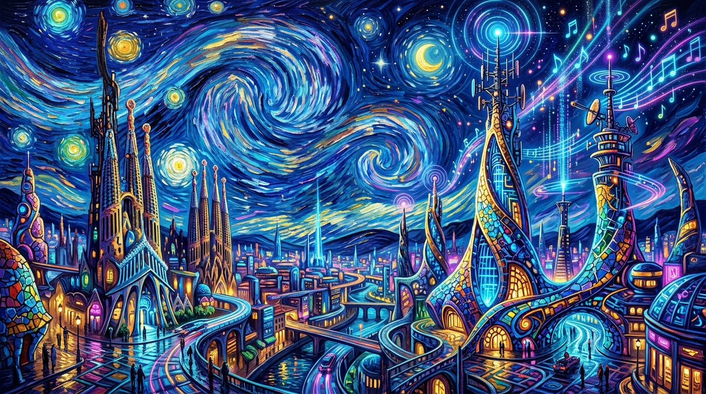
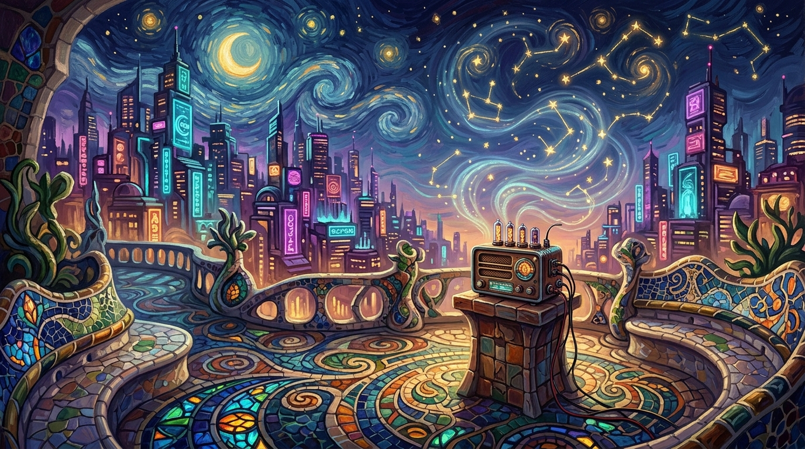

<p align="center">
  
</p>

<h1 align="center">🌌 Folk Anecdotes & Radio | Кибер-Фольклор</h1>

<p align="center">
  <strong>Синтез экспрессивных вихрей Ван Гога, биоморфной органики Гауди и неоновой эстетики Киберпанка</strong><br>
  <em>Интеллектуальный рассказчик народных анекдотов, культурные дайджесты новостей и живое интернет-радиовещание нового поколения.</em>
</p>

<p align="center">
  
  
  
  
  
  
  
</p>

---

## 🌟 О проекте

**Folk Anecdotes & Radio** — это уникальное мультимедийное Android-приложение, объединяющее живую традицию народной сатиры и анекдотов с высокотехнологичным интернет-вещанием и алгоритмами искусственного интеллекта на базе Gemini.

Визуальный язык приложения вдохновлён смелым сплавом трёх направлений искусства:
* 🎨 **Ван Гог (Vincent van Gogh)** — густые импасто-мазки, спиралевидные звёздные вихри, глубокий ультрамарин и сияющее солнечное золото.
* 🏛️ **Антони Гауди (Antoni Gaudí)** — плавные текучие природные формы, мозаичные текстуры в технике *trencar/trencadís*, витражные переливы и архитектурная органика Саграда Фамилия.
* ⚡ **Киберпанк (Cyberpunk)** — неоновый циановый и пурпурный свет, цифровые аудиоволны, голографические радиовышки, кибернетические ламповые интерфейсы и глубокий темный фон.

---

## ✨ Ключевые возможности

### 📻 Непрерывный медиаплеер (Persistent Bottom Media Player)
* **Всегда под рукой**: компактный плавающий плеер поверх всех экранов приложения, не перекрывающий основной контент.
* **Потоковое радио в реальном времени**: воспроизведение популярных международных и локальных онлайн-радиостанций (HLS / AAC / MP3).
* **Интерактивный Seek Bar & LIVE-буфер**:
  * Индикатор реального времени с бейджем **`● LIVE`**.
  * Возможность перемотки назад по буферу прямого эфира (`-00:45` и т.д.).
  * Мгновенный возврат к живому эфиру в один клик.
* **Встроенный регулятор громкости**: выдвижная панель настройки звука прямо из плеера.
* **Навигация по станциям**: быстрое переключение «Предыдущая / Следующая» и добавление в избранное.
* **Двойной движок воспроизведения**: нативный `Android MediaPlayer` + резервный `HTML5 Web Audio Bridge` для стабильной работы с нестандартными аудиокодеками.

### 🎭 Рассказчик анекдотов (Folk Anecdotes Storyteller)
* **Богатая база фольклора**: юмор и мудрость различных культур мира (русский, восточный, латиноамериканский, кельтский, азиатский фольклор).
* **AI-генерация и стилизация**: адаптация историй под выбранное настроение и культурный контекст при помощи Gemini AI.
* **Аудио-сопровождение**: возможность фонового прослушивания эфира радио во время чтения историй.

### ⚡ Дайджест новостей и культурные мемы (X.com / News Trends)
* **Тренды с юмором**: интеллектуальный подбор народных анекдотов и остроумных метафор к актуальным мировым трендам и новостным заголовкам.
* **Синтез веков**: современные технологии и события через призму вековой народной мудрости.

### 🎨 Кастомизация и дизайн-стили
* **Динамические стили оформления**:
  * 🌌 *Van Gogh Starry Night* (Звездная ночь Ван Гога)
  * 🦎 *Gaudí Trencadís Mosaic* (Органическая мозаика Гауди)
  * 🌆 *Neo-Tokyo Cyberpunk* (Неоновый киберпанк)
  * 🕌 *Registan Turquoise* (Самаркандский Регистан)
  * 🏺 *Giza Golden Amber* (Золото древней Гизы)
  * 🦚 *India Cyber-Rangoli* & 🏔️ *Inca Sun Temple*
* **Полная мультиязычность**: поддержка 10 языков (Русский, English, Español, 中文, हिन्दी, العربية, বাংলা, Português, Deutsch, 日本語).

### 💾 Офлайн-архитектура и сохранность данных
* Локальная база данных **Room (SQLite)**: избранные анекдоты, кастомные радиостанции и история прослушивания сохраняются на устройстве.

---

## 🏗 Архитектура и технологии

```
                       ┌────────────────────────────────────────┐
                       │          Jetpack Compose UI            │
                       │ (Storyteller, News, Radio, Favorites)  │
                       └──────────────────┬─────────────────────┘
                                          │ StateFlow / Events
                                          ▼
                       ┌────────────────────────────────────────┐
                       │              AppViewModel              │
                       │    (MVI/MVVM State Orchestration)      │
                       └──────────┬──────────────────┬──────────┘
                                  │                  │
                ┌─────────────────┴────┐        ┌────┴─────────────────┐
                ▼                      ▼        ▼                      ▼
    ┌──────────────────────┐  ┌─────────────┐  ┌─────────────┐  ┌──────────────┐
    │     RadioManager     │  │  Gemini AI  │  │ AppDatabase │  │ Localization │
    │ (MediaPlayer+WebBridge)  (Flash SDK)  │  │   (Room)    │  │ (10 Langs)   │
    └──────────────────────┘  └─────────────┘  └─────────────┘  └──────────────┘
```

| Компонент | Используемая технология |
| :--- | :--- |
| **Язык разработки** | Kotlin 2.0+ (100% Coroutines & Flow) |
| **UI Фреймворк** | Jetpack Compose + Material Design 3 (M3) |
| **Аудиодвижок** | Android `MediaPlayer` API + Fallback HTML5 Streaming Bridge |
| **База данных** | Room ORM + KSP (Kotlin Symbol Processing) |
| **Нейросетевой слой** | Google Gemini API (Server-side & Direct SDK) |
| **Интернационализация** | Двусторонний `LocalizationManager` (10 мировых языков) |
| **Сборка** | Gradle (Kotlin DSL - `.gradle.kts`) |

---

## 📂 Структура проекта

```bash
├── app/
│   ├── src/main/
│   │   ├── java/com/example/
│   │   │   ├── data/
│   │   │   │   ├── database/        # Room Database, DAO и Entities
│   │   │   │   ├── radio/           # RadioManager, аудиосервис, контроллер потоков
│   │   │   │   └── FallbackData.kt  # Предустановленные станции и фольклор
│   │   │   ├── ui/
│   │   │   │   ├── components/      # UI-компоненты, визуализаторы звука, плеер
│   │   │   │   ├── screens/         # Главный экран и вкладки приложения
│   │   │   │   ├── theme/           # Цветовые палитры, шрифты, стили Гауди/Ван Гога
│   │   │   │   ├── utils/           # Модуль мультиязычной локализации
│   │   │   │   └── viewmodel/       # AppViewModel и реактивное состояние
│   │   │   └── MainActivity.kt      # Точка входа в приложение
│   │   └── res/                     # Векторные и графические ресурсы
├── docs/
│   └── images/                      # Арт-баннеры и иллюстрации Ван Гог + Гауди + Киберпанк
├── app-debug.apk                    # Готовый скомпилированный установочный файл APK
├── build.gradle.kts                 # Конфигурация сборки модулей
└── README.md                        # Документация проекта
```

---

## 🚀 Быстрый старт

### Требования
* Android Studio Ladybug / Meerkat или новее
* Android SDK 34 (минимальная версия: Android 8.0, API 26)
* JDK 17 или 21

### 1. Клонирование репозитория
```bash
git clone https://github.com/your-username/folk-anecdotes-radio.git
cd folk-anecdotes-radio
```

### 2. Настройка переменных окружения (опционально для AI)
Скопируйте пример файла конфигурации:
```bash
cp .env.example .env
```
Укажите ваш ключ Gemini API (если требуется генерация пользовательских историй):
```properties
GEMINI_API_KEY=your_api_key_here
```

### 3. Сборка и запуск через Gradle
Собрать отладочный APK:
```bash
gradle assembleDebug
```
Готовый установочный файл будет сгенерирован по пути:
```
./app/build/outputs/apk/debug/app-debug.apk
```
*(Также копия доступна прямо в корне проекта: `./app-debug.apk`)*

---

## 🎨 Философия стиля: Ван Гог + Гауди + Киберпанк

Дизайн приложения базируется на трёх принципах:

1. **Экспрессия света и движения (Ван Гог):**
   * Все градиенты и индикаторы аудио-активности имитируют динамичные мазки кисти.
   * Контраст ночного неба (`#0A0E1A`) и теплого звездного свечения (`#FFD166`, `#F59E0B`).

2. **Биоморфная гармония (Гауди):**
   * Скругленные, естественные формы плавающего плеера и диалоговых окон (`shape = RoundedCornerShape(24.dp)`).
   * Мозаичные акцентные текстуры карточек станций и историй.

3. **Технологичность и точность (Киберпанк):**
   * Неоновые линии эквалайзера (`#00F0FF`, `#D946EF`).
   * Ламповые индикаторы воспроизведения и интерактивные слайдеры с неоновым свечением.

---

## 🤝 Вклад в проект (Contributing)

Мы рады любым предложениям по добавлению новых радиостанций, народных историй и визуальных тем!
1. Форкните репозиторий (`Fork`).
2. Создайте свою ветку (`git checkout -b feature/cyber-folklore-feature`).
3. Зафиксируйте изменения (`git commit -m 'Add new station and Van Gogh theme'`).
4. Отправьте ветку в Origin (`git push origin feature/cyber-folklore-feature`).
5. Создайте **Pull Request**.

---

<p align="center">
  
</p>

<p align="center">
  <em>«Искусство — это человек, добавленный к природе, а юмор — лучший проводник сквозь время и волны эфира.»</em><br>
  <strong>Folk Anecdotes & Radio</strong> • Разработано с любовью к искусству, звуку и традициям.
</p>
